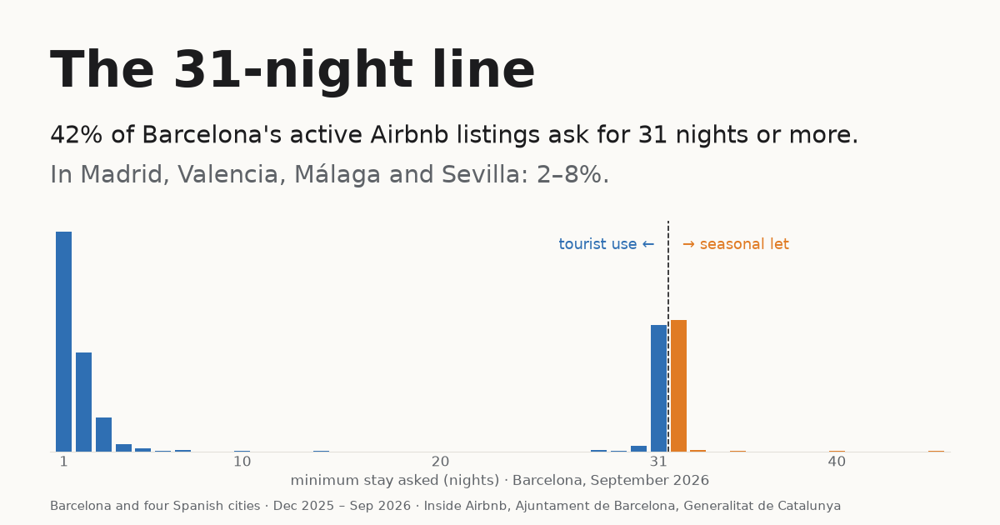

# The 31-Night Line

**Short-term rentals and housing rules in Barcelona and four Spanish cities:
what the data shows, and what it cannot show.**

**Live site:** https://renzorico.github.io/spain-housing-str-analysis/



Four quarterly snapshots of Airbnb listings (Dec 2025 – Sep 2026) for
Barcelona, plus Madrid, Valencia, Málaga and Sevilla, set against
Barcelona's official register of tourist flats and official rents of new
leases. Each housing rule is treated as a **policy lever**: what it says,
what the data shows, and what the data cannot show. No verdicts, no party
positions.

Context: Spain holds an early general election on 29 Nov 2026 and municipal
elections on 23 May 2027. The rules below sit at different levels (municipal
planning and enforcement, Catalan regulation, state tenancy law), and neither
election decides all of them.

---

## What the data shows

Population throughout: Airbnb **listings with open dates** (at least one open
date in the next 365 days). Listings are labelled by the minimum stay they
**ask** (under 31 / exactly 31 / over 31 nights), never by legality: a minimum
stay is a setting, not a contract, an actual stay or a legal finding.

**1. Barcelona's market sits on the legal line.** In Catalonia a tourist flat
is let for "31 days or fewer". 41.7% of Barcelona's listings with open dates
ask for 31 nights or more (September 2026), against 7.8% in Madrid and about
2% in Valencia, Málaga and Sevilla. Minimum stays pile up at exactly 31
nights (2,293 listings) and 32 nights (2,383): together 39.8% of the 11,737
listings with open dates. (In the whole file, including listings with no open
dates, the counts are 2,504 and 2,505.) The share is 41.7% / 41.5% / 39.9%
depending on whether the population is listings with open dates, those plus
listings reviewed in the last 12 months, or every listing.

**2. Listings asking exactly 31 nights look like those asking over 31, not
those asking under 31.** Only 0.7% of them show a tourist-flat (HUT) licence,
against 76.9% of listings asking under 31. Median asking prices: €82.5 (exactly
31), €72 (over 31), €245 (under 31). The €10.5 gap between exactly-31 and
over-31 is not distinguishable from zero once host accounts are resampled
(−15 to +44).

**3. The seasonal-rent limit cannot be singled out.** Month-plus listings were
16.3 points more likely than shorter-stay ones to be absent from the September
scrape (95% interval 6.2 to 26.6, resampling host accounts). Málaga (+21.1) and
Sevilla (+15.5) are also above zero; Madrid (+2.1) and Valencia (+12.1)
include zero. **Barcelona minus each other city: every interval includes
zero**, so the data cannot distinguish Barcelona's gap from any other city's,
including cities where the Catalan law does not apply. That neither supports
nor rules out an effect of the law.

**4. Most licence numbers shown exist in the register.** 83.5–86.0% of the
distinct HUT numbers on listings with open dates are in the register quarter
nearest to each snapshot. 37–49% of the register's numbers are displayed on at
least one such listing. That is displayed-number coverage, not "the share of
licensed flats on Airbnb". The register has not shrunk ahead of the 2028
deadline (10,514 to 10,730 records, 2025 Q1 – 2026 Q3).

**5. Supply is concentrated.** The largest 1% of host accounts run 29% of
Barcelona's listings with open dates (Madrid about 28%, Valencia 16%). An account is
not necessarily one owner or one company. Licensed and unlicensed listings are
run by accounts of similar size (66.0% vs 64.5% belong to accounts with 5+
listings), so the phase-out does not reach larger accounts more than smaller
ones.

**6. Rents of new leases.** Year-on-year growth went from +9.8% (Q1 2024, just
before the limit) to −8.9% (Q1 2025), then back to +4.6% (Q1 2026, €1,137 a
month). The timing is shown; the cause is not.

---

## How the conclusions were checked

- **Comparisons use all the cities, and test differences.** Against Madrid
  alone, Barcelona's exit gap first looked exceptional (a listing-level z-test
  gave p ≈ 10⁻²⁷). Resampling host accounts, one operator withdrawing many
  listings at once no longer counts as many independent observations, and the
  Barcelona–Madrid difference is +14.2 points with an interval of −10 to +33.
  **The z-test was wrong and is withdrawn.** Overlap between separate intervals
  is never used as a test.
- **Suspicious numbers get a root cause before a sentence.** A first pass found
  only 60% of licence numbers matching the register; the cause was parsing
  (in the national code the HUT number is glued to other digits). Read from the
  regional field, the match is 86%, and a test pins it.
- **One population, one definition.** Aligning the notebooks with the site's
  population changed findings: "the phase-out reaches larger accounts more" was
  +21.7 points when listings with no open dates were counted and is +1.5
  (within chance) on listings with open dates, and a claim that most unlicensed
  listings were private rooms with little activity was wrong (63% are entire
  homes; 64% were reviewed in the past year). Both are corrected.
- **Data changes are reported, not hidden.** Every Dec 2025 snapshot has no
  prices, and Airbnb's licence form changed during these months, so licence
  categories are never compared as a before/after effect of a rule.
- **Every published percentage has its numerator and denominator** in the
  exported data, and tests check that they agree.
- **Independent review.** Another model (Codex) audited the project on 22 Oct
  2026. Its findings on the owners' rule, the intervals, the population
  definition and the neighbourhood totals were reproduced and fixed here; one
  of them (the owners' vote rule applied the national 3/5 majority to Barcelona,
  where Catalan law requires 4/5) was a factual error on the live site.

---

## The rules checked against the data

Selected rules, not every rule in force; texts checked against the official
gazettes (BOE, DOGC) on 22 Oct 2026. Rules with the same purpose differ between
Catalonia and the rest of Spain, so each has its jurisdiction.

| Rule | Where | What it says | What the data can show |
|---|---|---|---|
| Tourist-flat licence phase-out (Decret llei 3/2023; STC 64/2025) | Catalonia | Existing tourist flats (HUT) need an urban-planning licence by 9 Nov 2028 or must stop; one extension of up to 5 years can be requested | Who holds licensed listings, how listings match the register |
| Rent limit in stressed zones (Ley 12/2023, LAU art. 17.6–7) | Barcelona's zone, from 16 Mar 2024, extended Oct 2026 | A new lease cannot exceed the last rent of the previous five years (+10% in listed cases); large landlords are limited by the reference index | The timing of rent changes, not their cause |
| Limit extended to seasonal lets (Llei 11/2025; challenged, admitted 9 Jun 2026) | Catalonia, from 1 Jan 2026 | A seasonal let not for exclusively holiday or leisure use counts as a housing lease | Listings around the 31-night line, and how they changed after January |
| Owners' vote on tourist use (Catalan Civil Code art. 553-26.2.a) | Catalonia (Barcelona) | Changing a community's statutes needs 4/5 of owners and 4/5 of shares | Nothing directly: no building-level data |
| Owners' approval of tourist lets (LPH arts. 5.3 and 17.12, LO 1/2025) | Rest of Spain (Madrid, Valencia, Málaga, Sevilla), from 3 Apr 2025 | New tourist lets need prior approval, adopted by 3/5 of owners and shares | Nothing directly: no building-level data |

After the data: Real Decreto-ley 29/2026 (published 7 Oct 2026) amends the
national tenancy law on temporary and room rentals. It post-dates every
snapshot, so it cannot explain any change here; its parliamentary validation was
not checked.

All dates, law numbers and primary sources are in `src/config.py`
(`POLICY_LEVERS`, `POST_OBSERVATION_DEVELOPMENTS`).

---

## Limitations

- **Asking terms, not behaviour.** Prices are asking prices, and a minimum
  stay is what a host asks for, not how long guests stay or how a stay is
  classified in law.
- **Airbnb only.** Listings on other platforms, or let directly, are not here.
- **An empty calendar is ambiguous.** It can mean booked, blocked or
  withdrawn. A listing absent from a later scrape may have been withdrawn,
  re-listed under a new id, or missed by the scrape.
- **A missing or unmatched licence is not proof of an illegal listing,** and a
  match is not proof of a legal one: it shows a number exists in the register,
  not that the listing is that property.
- **Intervals cover sampling variation only,** by resampling host accounts. They
  do not cover scrape omissions, platform changes or confounding, and none of
  them is an estimate of a policy's effect. Three quarters of data, and the
  other cities have only December and September snapshots, so the Dec–Mar dip
  in Barcelona cannot be separated from an ordinary winter pattern.
- **Data quality.** All Dec 2025 snapshots lack prices. The share of listings
  with no open dates jumps in every city's Sep 2026 snapshot. Tourist-licence
  shares outside Catalonia are a lower bound (only confirmed regional codes
  are counted). The five cities were scraped on different days (listed on the
  site).
- **Rents are city-wide.** Official rents are published per municipality, not
  per district, and change with the mix of flats rented.
- **Correlations, not causes.** Nothing here was randomly assigned.

Details: [`data/README.md`](data/README.md).

---

## Project structure

```
├── notebooks/
│   ├── 01_cleaning_eda          one Barcelona snapshot: cleaning, the 31-night line, licences
│   ├── 02_statistics            confidence intervals, t-tests, z-tests, chi-square
│   ├── 03_change_over_time      four snapshots, five cities, listing flows, robustness check
│   └── 04_register_and_rents    official register vs listings, rents of new leases
├── src/
│   ├── config.py                thresholds, settings and policy levers (dates, laws, sources)
│   ├── sources.py               every raw-data URL and local path
│   ├── cleaning.py              loading, cleaning rules, licence parsing
│   ├── metrics.py               shared metrics for the notebooks and the site
│   └── official.py              loaders for the HUT register and rents
├── scripts/
│   ├── download_data.py         fetch all raw data into data/raw/
│   ├── export_site_data.py      write the site's JSON into site/public/data/
│   └── make_social_image.py     draw the social preview image from that JSON
├── site/                        Vite + TypeScript + Observable Plot + MapLibre
├── tests/                       cleaning, metrics, official data, policy records, and checks on the site data (privacy, totals, denominators)
├── data/                        gitignored raw data - see data/README.md
└── reports/figures/             charts saved by the notebooks
```

---

## Running it

**Analysis** (Python 3.12):

```bash
python -m venv .venv && source .venv/bin/activate
pip install -r requirements.txt

python scripts/download_data.py      # ~51 MB into data/raw/
python -m pytest -q
jupyter lab notebooks/
```

**Website** (Node 22+):

```bash
python scripts/export_site_data.py   # refresh site/public/data/
python scripts/make_social_image.py  # refresh site/public/og-image.png

cd site
npm ci
npm run dev                          # http://localhost:5173
npm run build                        # typecheck + build into site/dist/
```

No environment variables or API keys are needed. The basemap comes from
[OpenFreeMap](https://openfreemap.org).

**Deploy:** pushing to `main` runs `.github/workflows/deploy-site.yml`. It
checks the exported data for identifying fields, builds the site and
publishes it to GitHub Pages. One-time setup: in the repository settings,
set **Pages → Source** to **GitHub Actions**.

---

## Privacy

Under EU rules the Airbnb `license` field can contain host names and
addresses, and Barcelona's register lists each flat down to the door. Raw
licence text is read in three functions only (`src/cleaning.py`), register
addresses never leave `src/official.py`, and the website data contains no
listing ids, host ids, names, licence text or addresses.
`tests/test_export.py` checks this before every deploy.

---

## Licence and attribution

Code: [MIT](LICENSE). Data: [Inside Airbnb](https://insideairbnb.com/get-the-data/),
[Ajuntament de Barcelona](https://opendata-ajuntament.barcelona.cat/data/ca/dataset/habitatges-us-turistic)
and [Generalitat de Catalunya](https://analisi.transparenciacatalunya.cat/d/qww9-bvhh),
all [CC BY 4.0](http://creativecommons.org/licenses/by/4.0/). Basemap ©
OpenStreetMap contributors, OpenMapTiles, OpenFreeMap.
